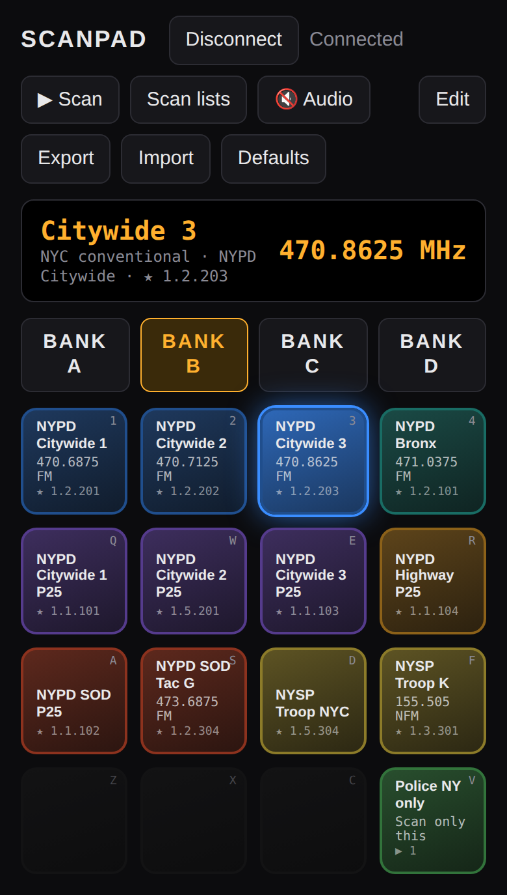
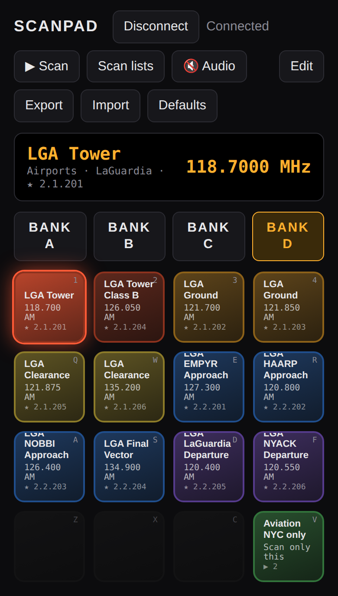
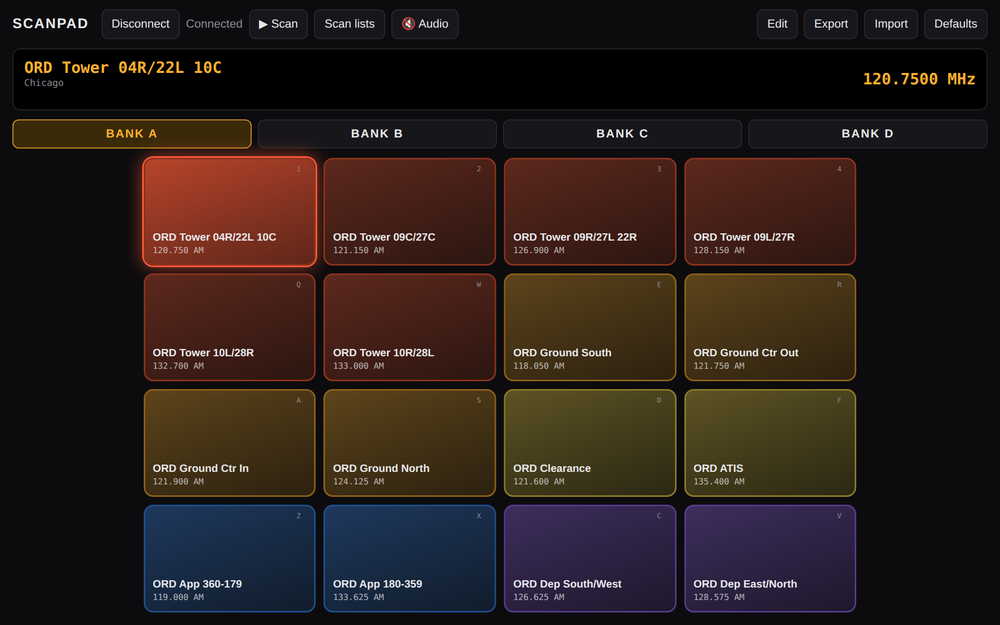
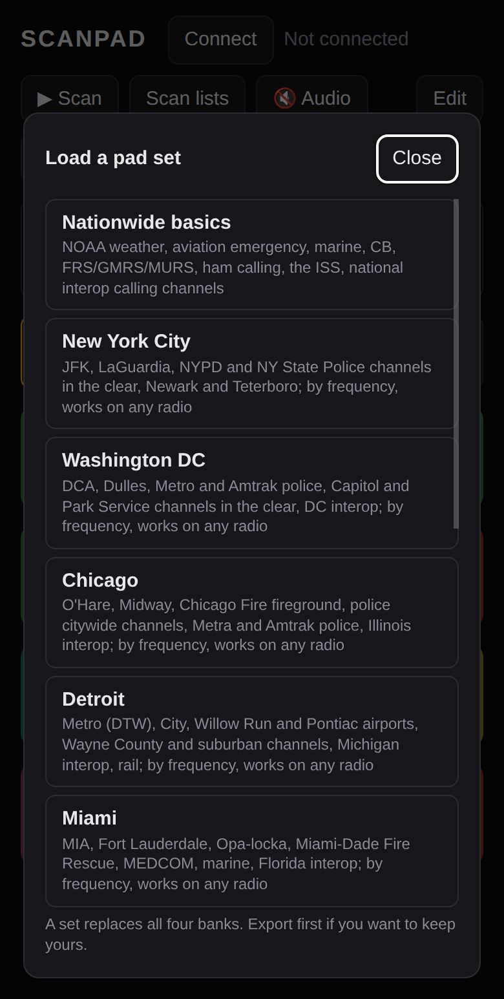
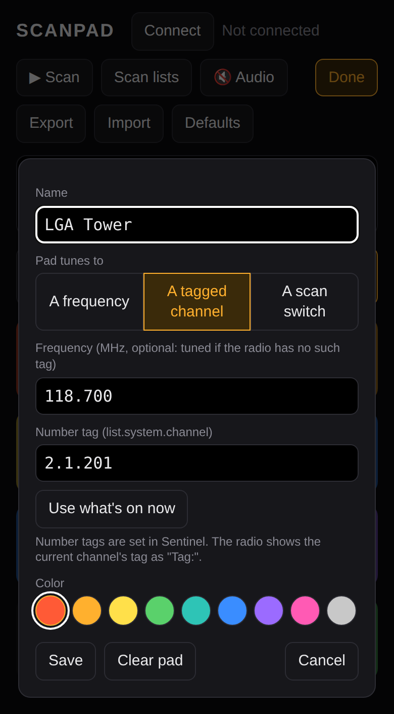
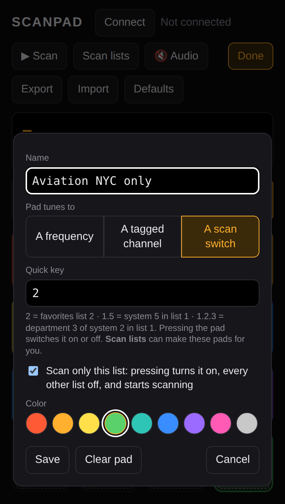

# ScanPad

A drum-machine style pad for the **Uniden SDS150** scanner. Each pad holds a
channel; tap it and the radio jumps there and holds. Four banks of 16 pads,
one-tap scan-list switches, and the radio's audio played on your phone or PC.

It runs in the browser over Bluetooth. No app to install, no account, no
server: open the page, tap **Connect**, pick your radio.

**Open it: <https://gonzalu.github.io/ScanPad/>**

<p align="center">
  
  &nbsp;
  
</p>

<p align="center">
  
</p>

## What it does

- **One-tap tuning.** A pad tunes a frequency, or jumps to a channel in your
  favorites lists by its Sentinel number tag. The pad the radio is on glows,
  and the strip above the pads shows what the radio's screen says.
- **Scan-list switches.** A pad can turn a favorites list, system or
  department on or off. A **scan-only** pad turns one list on, every other list
  off, and starts scanning, all in one press.
- **Audio.** The SDS150 sends its sound over Bluetooth; ScanPad plays it on the
  device you're holding.
- **Ready-made pad sets** for nine US cities, plus a nationwide set, picked
  from a list.
- **Your pads stay on your device**, and move to another one with Export and
  Import.
- Swipe between banks on a phone; play it from the keyboard on a PC.

## Where it runs

| Device | Browser |
| --- | --- |
| Windows / Mac / Linux / Android | Chrome or Edge |
| iPhone / iPad | [Bluefy](https://apps.apple.com/app/bluefy-web-ble-browser/id1492822055) (Safari has no Web Bluetooth) |

The SDS150 takes only **one Bluetooth connection at a time**, so close U/AWARE,
AlphaScan or any other scanner app first.

## Quick start

1. Turn on the SDS150's Bluetooth.
2. Open <https://gonzalu.github.io/ScanPad/> in Chrome (or Bluefy on an
   iPhone).
3. Tap **Connect** and pick **SDS150** from the list.
4. Tap a pad. The radio tunes there and holds; the pad glows.
5. Tap **▶ Scan** to let the radio scan again.

A first visit loads the **Nationwide basics** set: NOAA weather, aviation
emergency, marine, ham calling channels, the ISS and more. Tap **Defaults** to
pick a set for your city.

## How to

### Load a set for your city

1. Tap **Defaults**.
2. Pick a set from the list.
3. Confirm. The set replaces all four banks.

Tap **Export** first if you want to keep the pads you have.

The city sets put the main airport on bank A, the other airports on B, police,
fire and EMS channels on C, and weather, state police, interop, marine and
rail on D. See [Pad sets](#pad-sets) for the full list.

<p align="center"></p>

### Add or change a pad

1. Tap **Edit**. The pads get a dashed outline.
2. Tap the pad to change, or an empty one (**+ add**).
3. Give it a name and choose what it tunes to:
   - **A frequency**: type it in MHz, e.g. `162.55`.
   - **A tagged channel**: type its number tag, e.g. `2.1.201`. See the next
     how-to.
   - **A scan switch**: a quick key, e.g. `2`. See
     [Make a scan-only pad](#make-a-scan-only-pad).
4. Pick a color and tap **Save**.
5. Tap **Done** when you've finished.

**Clear pad** empties it. To fill a pad from whatever the radio is on right
now, tap **Use what's on now**.

<p align="center"></p>

### Jump to a channel in your favorites by number tag

Frequency pads can't follow trunked talkgroups (P25 and the like): a talkgroup
has no single frequency. Number tags fix that. The radio jumps straight to the
channel you tagged, trunked or not.

1. In **Sentinel**, open your favorites list and give the list, the system and
   the channel a **Number Tag**. For example list `1`, system `2`, channel
   `203`.
2. Write the list to the radio.
3. In ScanPad, make a pad of the **A tagged channel** kind with tag `1.2.203`
   (list . system . channel).

The radio shows a channel's tag on its screen as `Tag:`. ScanPad shows it as
★ on the pad and in the display strip.

Add a frequency to a tag pad as well, and it still works on a radio that
doesn't have that tag: it tunes the frequency instead. That's how the author's
own sets work on anyone's radio.

### Make a scan-only pad

One press: this favorites list on, every other list off, and the radio
scanning. For example, an "Aviation only" pad and a "Police only" pad.

1. Tap **Edit**, then an empty pad.
2. Choose **A scan switch**.
3. Type the list's quick key, e.g. `2`.
4. Tick **Scan only this list**.
5. **Save**, then **Done**.

The pad shows **Scan only this**, then **Switching…** while the radio changes
over (about five seconds; the radio stops answering for a moment after a
switch), then **SCANNING**. It glows while its list is the only one on.

Without the tick, a scan switch is a plain on/off switch, and it works for
systems (`1.5`, system 5 in list 1) and departments (`1.2.3`) too.

<p align="center"></p>

### Turn lists, systems and departments on and off

1. Tap **Scan lists**. You see the favorites lists on the radio, each with an
   on/off switch.
2. Tap a list to see its systems, and a system to see its departments.
3. Flip a switch to change what the radio scans.
4. **+ pad** puts a switch for it on the current bank.
5. **✎** gives it a name.

These are the radio's quick keys, so only the ones you assigned in Sentinel
appear. The radio can't send names over Bluetooth; ScanPad picks up list and
system names from its screen as you scan, and you can type the rest.

### Listen on your phone or PC

1. Connect to the radio.
2. Tap **🔇 Audio**. It turns to **🔊 Audio** and the radio's sound plays here.
3. Tap it again to stop.

Browsers only start sound after a tap, so this needs one each time you open
the page. The radio sends its sound in step with what it's asked, so while
audio is on ScanPad asks for the radio's screen four times a second.

### Change banks

- **Phone or tablet:** swipe left or right across the pads, or tap
  **Bank A–D**.
- **Keyboard:** the arrow keys.

### Use it from the keyboard

The 16 pads are mapped to the left side of the keyboard. Each pad shows its
key in the corner.

|   |   |   |   |
| --- | --- | --- | --- |
| `1` | `2` | `3` | `4` |
| `Q` | `W` | `E` | `R` |
| `A` | `S` | `D` | `F` |
| `Z` | `X` | `C` | `V` |

`←` `→` switch banks. `Space` sends the radio back to scanning.

### Move your pads to another device

1. On the first device, tap **Export**. It saves `scanpad.json`.
2. Move the file to the other device (AirDrop, email, a cloud drive).
3. On the other device, tap **Import** and pick the file.

Pads are kept in the browser on each device; nothing is stored online.

## Pad sets

**Defaults** lists the sets in [`pads/index.json`](pads/index.json).

| Set | What's in it |
| --- | --- |
| Nationwide basics | NOAA weather WX1–WX7, aviation emergency and air-to-air, marine, CB, FRS/GMRS/MURS, ham calling frequencies, APRS, the ISS, national interop calling channels |
| New York City, Washington DC, Chicago, Detroit, Miami, Atlanta, Austin, Denver, Los Angeles, San Francisco | Bank A the main airport (tower, ground, clearance, ATIS, approach, departure), B the other airports, C police, fire and EMS channels that are in the clear, D weather, state police, interop, marine and rail |
| New York: N2MAV's radio | The author's own: NYPD and NY State Police, JFK, LaGuardia |
| NY area airports: N2MAV's radio | Newark, Teterboro, Stewart, Westchester, Republic, MacArthur, Gabreski |

The city sets tune by frequency, so they work on any SDS150. They only hold
conventional channels: most big-city police and fire dispatch is on trunked
digital systems, often encrypted, and a frequency pad can't follow a trunked
talkgroup. Each city file's `notes` says what was left out and why, and its
`sources` where the frequencies came from. Frequencies change; corrections are
welcome.

The two N2MAV sets jump by number tag to channels in the author's favorites
lists (Police NY is list 1, Aviation NYC is list 2), with the frequency as a
fallback. On your radio a tag pad tunes its frequency instead, unless you give
your channels the same tags in Sentinel (or edit the tags in the file; an AI
can do the renumbering for you). Trunked talkgroups have no frequency to fall
back on.

## Troubleshooting

| What you see | What to do |
| --- | --- |
| No SDS150 in the Connect list | Turn on the radio's Bluetooth. Close U/AWARE, AlphaScan or anything else connected to it; the radio takes one connection at a time. |
| Connect does nothing on an iPhone | Safari has no Web Bluetooth. Use [Bluefy](https://apps.apple.com/app/bluefy-web-ble-browser/id1492822055). |
| "Link dropped, reconnecting…" | The SDS150 drops a Bluetooth link by itself now and then. ScanPad reconnects on its own, retrying for about three minutes. |
| A tag pad doesn't jump | The radio has no channel with that tag. Check the tag in Sentinel, or add a frequency to the pad so it tunes that instead. |
| A switch pad stays on **Switching…** for a few seconds | Normal: the radio stops answering for a few seconds after a quick-key change. |
| No sound | Tap **🔇 Audio** (it needs a tap each visit). Check the device's volume. |
| A pad set doesn't show up right after an update | GitHub Pages caches for about ten minutes. Reload the page. |

## Make your own pads

Build pads in the app with **Edit**, then **Export** to keep them. Or write a
`scanpad.json` by hand (or ask an AI to) and **Import** it. Feel free to fork
the project and ship your own sets. The format is four banks of 16 pads each
(`null` is an empty pad):

```json
{
  "bank": "A",
  "banks": {
    "A": [
      { "name": "NOAA WX1", "mhz": "162.5500", "mode": "NFM", "color": "#5ad16b" },
      { "kind": "tag", "name": "LGA Tower", "tag": "2.1.201", "mhz": "118.7000", "mode": "AM", "color": "#ff5a36" },
      { "kind": "qk", "name": "Aviation only", "qk": "2", "only": true, "color": "#5ad16b" },
      null
    ],
    "B": [], "C": [], "D": []
  }
}
```

- `mhz`: frequency in MHz. Required unless the pad has a tag.
- `kind: "tag"` with `tag`: jump to the channel with this Sentinel number tag
  (favorites list . system . channel).
- `mode`: shown on the pad only; the radio picks the modulation itself.
- `kind: "qk"` with `qk`: a scan switch for that quick key (`"2"`, `"1.5"`,
  `"1.2.3"`). Add `"only": true` on a list's switch to make it a scan-only
  pad.
- `color`: any CSS color.

The file can also carry `"names"`, keyed the same way (`{"1": "Police NY",
"1.5": "Metro-25"}`), to label the Scan lists panel.

To add a set to **Defaults**, put its file in `pads/` and list it in
`pads/index.json` with an `id` (the file name without `.json`), a `name` and
an `about` line.

## How it talks to the radio

The SDS150 exposes one custom BLE service (`3a5b9d10-f2ec-4f5c-bb2e-2f1a8d98a0a6`)
with one characteristic (`ab8c17d4-c1c5-4c91-8c56-7d01954c471e`) used for both
commands and replies. Commands are Uniden's usual ASCII remote commands, each
wrapped in a small binary "PT" frame; see the header of `sds150.js`.

| Pad | Command |
| --- | --- |
| Frequency | `QSH,<frequency in 100 Hz steps, 8 digits>`, e.g. `QSH,04708625` for 470.8625 MHz |
| Tagged channel | `JNT,<list>,<system>,<channel>`; the radio answers `JNT,OK`, or `JNT,NG` if nothing has that tag |
| ▶ Scan | `JPM,SCN_MODE,0` |
| Scan switch | `FQK` (lists), `SQK,<list>` (systems), `DQK,<list>,<system>` (departments) |
| Display strip | `GST` |

The quick-key commands each answer one line of 100 slots (0 = not assigned,
1 = off, 2 = on), and setting one sends all 100 back. The radio stops
answering for a few seconds after a switch.

Over Bluetooth the SDS150 delivers only the **last line** of a multi-line
reply, so commands that answer with lists (`GLT`, `GSI`) don't work; that's
why favorites channels are reached by number tag rather than browsed.

Audio arrives in the same frames as Opus packets (16 kHz mono, 20 ms each).
The radio sends them in step with host traffic: left alone it sends almost
none, so while audio is on ScanPad polls `GST` every quarter of a second, as
AlphaScan does. `speaker.js` decodes them with
[opus-decoder](https://github.com/eshaz/wasm-audio-decoders) and queues them
on a Web Audio clock.

## Run locally

```bash
python -m http.server 8150
```

Then open http://localhost:8150/ in Chrome. Web Bluetooth needs `https://` or
`localhost`.

## Files

- `index.html` — the pad
- `sds150.js` — SDS150 Bluetooth link: framing, replies, commands
- `speaker.js` — plays the radio's Bluetooth audio
- `vendor/opus-decoder.min.js` — Opus decoder in WebAssembly, from
  [wasm-audio-decoders](https://github.com/eshaz/wasm-audio-decoders) (MIT)
- `probe.html` — a test bench for trying raw commands on the radio
- `pads/` — the pad sets, listed in `pads/index.json`
- `docs/screenshots/` — the pictures in this README

---

By Manny Gonzalez, N2MAV. Not affiliated with Uniden.
